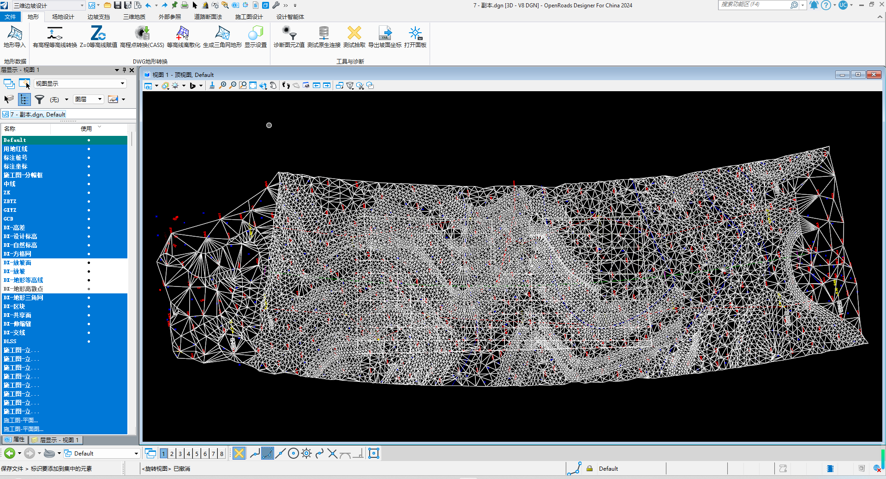
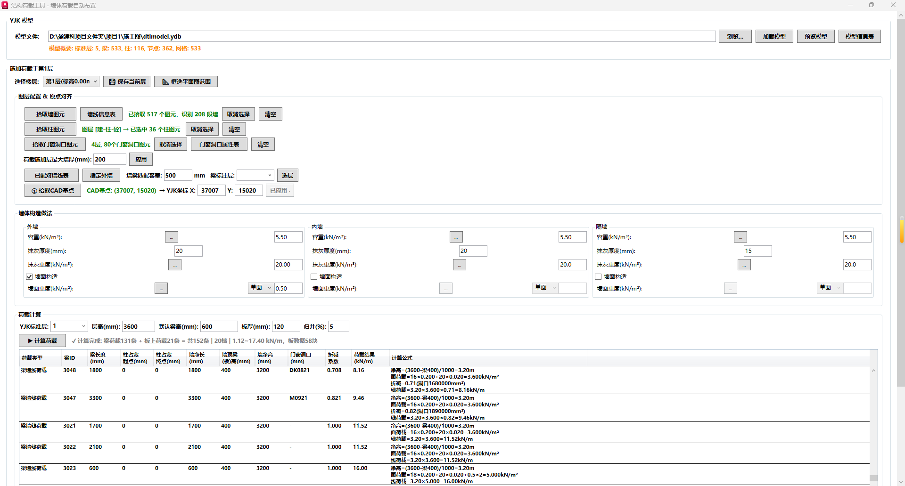

# 工程工具集合（my-engineering-projects）

本仓库收录三个面向工程与设计场景的自研工具，每个工具一个独立目录，各自包含完整的说明文档与界面截图。

## 目录

| 目录 | 简介 | 技术栈 |
| --- | --- | --- |
| [AI Agent](AI%20Agent/README.md) | 本地 AI Agent 工程助手：多轮对话、Skills、MCP、本地知识库 | FastAPI · LangChain · SQLite · 原生 JS |
| [三维边坡设计](三维边坡设计/README.md) | 基于 Bentley OpenRoads Designer 的三维边坡设计插件 | C# · .NET Framework 4.8 · WPF · CIM SDK |
| [结构荷载工具](结构荷载工具/README.md) | AutoCAD 墙体荷载自动计算并写回 YJK 模型 | C# · AutoCAD .NET API · YJK |

## 1. AI Agent — 工程助手

在浏览器里与模型多轮对话，按需调用技能、MCP 工具与本地知识库，也可把常用操作封装成插件或脚本一键执行。后端 FastAPI + LangChain，会话与配置存储于 SQLite；前端为零构建原生 JS 单页应用，回答通过 SSE 流式返回。


详细了解：[AI Agent/README.md](AI%20Agent/README.md)

## 2. 三维边坡设计 — ORD 3D Slope Designer

基于 Bentley OpenRoads Designer（China）的三维边坡设计插件，在 ORD 三维模型中完成地形处理、场地设计、支挡设计到施工图出图的全流程，无需在多个软件之间倒数据。



详细了解：[三维边坡设计/README.md](三维边坡设计/README.md)

## 3. 结构荷载工具 — CadBeamLoad

运行在 AutoCAD 2024 中的 .NET 插件，把建筑图里的墙体自动换算成线荷载，并写回 YJK 结构模型（.ydb）：

```
建筑图墙线(AutoCAD) ──拾取/配对──> 墙中线+墙厚 ──匹配梁板──> 线荷载 ──写回──> YJK .ydb
```



详细了解：[结构荷载工具/README.md](结构荷载工具/README.md)
