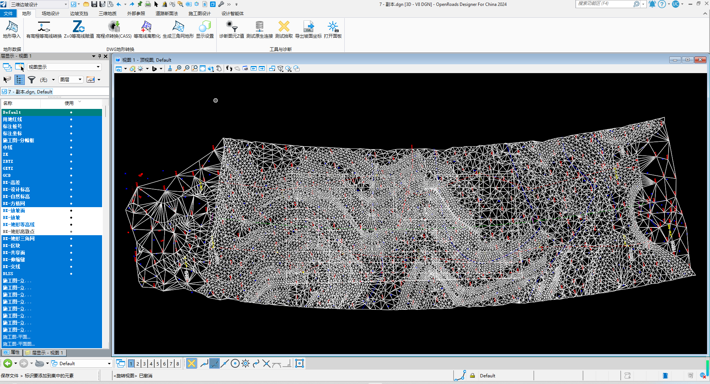
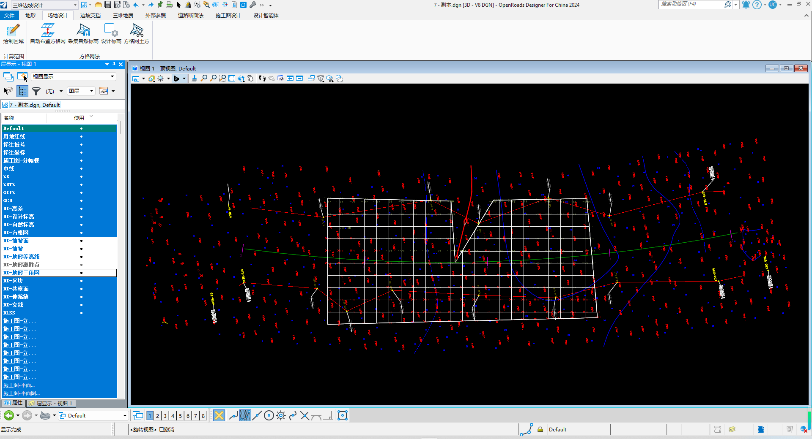
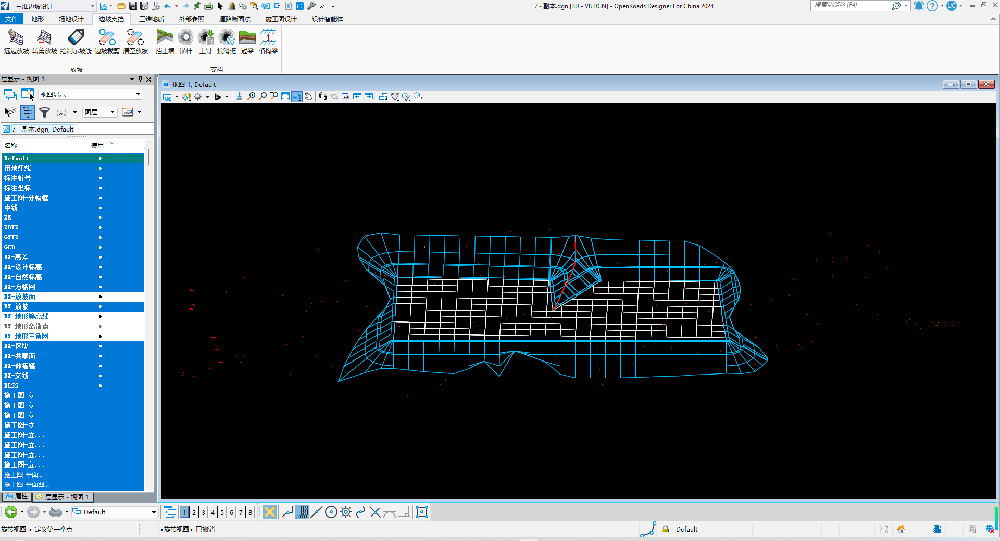
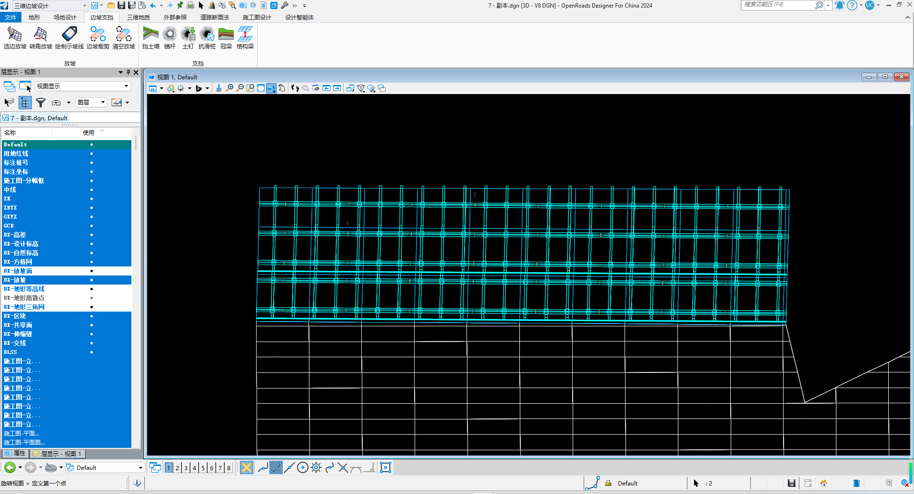
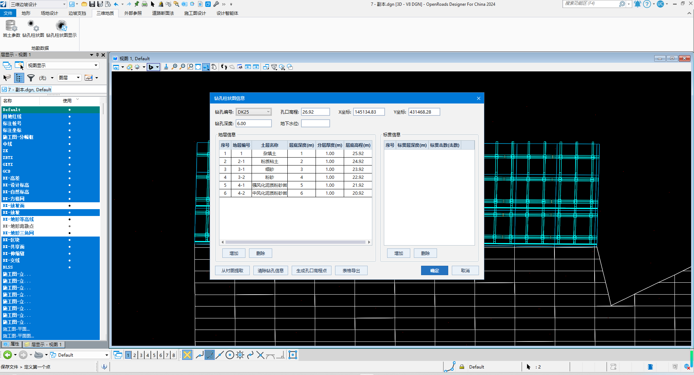
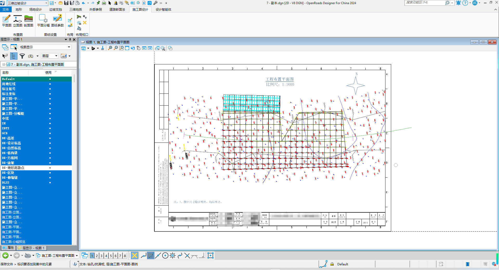

# 三维边坡设计（ORD 3D Slope Designer）

基于 **Bentley OpenRoads Designer（China）** 的三维边坡设计插件，在 ORD 的三维模型中完成从地形处理、场地设计、支挡设计到施工图出图的全流程，无需在多个软件之间来回倒数据。

## 技术栈

- **平台**：Bentley OpenRoads Designer (China)，以 AddIn（`mdlapps` DLL）+ Ribbon + keyin 命令方式集成
- **语言 / 运行时**：C# / .NET Framework 4.8
- **SDK**：Bentley DgnPlatformNET、GeometryNET、MicroStation 系列 API、CIM SDK（地形、放坡、廊道）
- **界面**：WPF + WinForms 混合（停靠面板、参数对话框、数据表窗口）

## 功能

### 地形处理
- 由离散点 / 等高线构建 TIN 地形曲面
- Z=0 等高线批量赋值（逐条 / 栅栏线成组），支持相邻等高线推算高程
- 兼容 CASS、飞时达等 DWG 地形图，提取高程点与等高线

### 场地设计
- 确定计算范围、方格网布置
- 自然标高 / 设计标高读取与编辑
- 地块土方平衡与场地整平所需的标高计算

### 支挡设计
- 三维放坡：多级坡（平台宽度 / 坡高 / 坡比），填方、挖方自适应，与自然地面自动求交
- 锚杆三维布置：按面片自动排布、随坡面标高联动
- 格构梁三维布置：竖梁顺坡、横梁沿走向，按间距铺满
- 挡土墙布置，支挡构件参数化与截面库联动
- 钻孔信息提取入库，生成地质柱状图，供支护设计参考

### 施工图设计
- 工程布置平面图、立面图、剖面图
- 剖面图自动切取设计坡面线、自然地面线与地层分界线
- 一键出图（平面 + 立面 + 构件图）、自定义图框、分幅与图纸参数
- 横断面与土方量计算（平均断面法）

## 效果预览

| 地形处理 | 方格网法 |
| --- | --- |
|  |  |

| 三维放坡 | 支挡布置 |
| --- | --- |
|  |  |

| 地勘钻孔提取 | 施工图出图 |
| --- | --- |
|  |  |

> 本插件依赖 Bentley 商业 SDK，仓库不包含相关程序集与授权文件。
